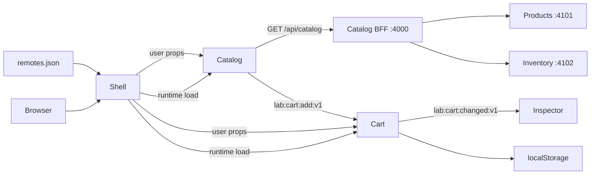

# Kiến trúc và thuật ngữ
## Ranh giới domain
Shell sở hữu navigation, layout, phiên demo; Catalog sở hữu sản phẩm/tìm kiếm; Cart sở hữu item/quantity/persistence.
Không import trực tiếp source của app khác. Props dành cho dữ liệu cha → con; CustomEvent v1 dành cho command domain giữa các app. Không chia sẻ một global Redux store cho toàn hệ thống.

## BFF đã triển khai
Catalog gọi services/catalog-bff/server.cjs qua HTTP để lấy dữ liệu ghép từ Products và Inventory. Shell vẫn chỉ ghép UI bằng Module Federation. Đọc [hướng dẫn BFF](BFF.md) để xem DTO, timeout, degraded response, lỗi và cách chạy từng service.

## Runtime composition
1. index.jsx dùng import('./bootstrap') tạo async boundary.
2. Shell đọc remotes.json lúc chạy, không hardcode URL remote vào bundle.
3. Loader gắn script remoteEntry.js: đây là container, chưa phải toàn bộ UI.
4. __webpack_init_sharing__ khởi tạo default scope; container.init chia sẻ dependency.
5. container.get('./App') trả factory; factory() trả module.
6. React.lazy đọc default export, Suspense hiển thị chờ, Boundary xử lý lỗi và retry.
7. publicPath auto giúp chunk của remote tải từ nơi remoteEntry được host.

## Chia sẻ dependency
React và react-dom dùng singleton với requiredVersion. Hai React runtime thường dẫn đến invalid hook call; singleton không tự sửa mọi bất tương thích phiên bản.
react-router-dom chỉ do Shell sở hữu. Remote nhận user bằng props nên không cần dùng chung Auth Context.
@lab/ui được mỗi app bundle tại build-time: đơn giản, có thể trùng CSS, cho phép mỗi app phát hành riêng; cần governance phiên bản khi tách repo.
CSS Modules cách ly class của từng remote; tokens.css là global có chủ đích. CSS Modules không phải Shadow DOM: reset, font, selector global vẫn ảnh hưởng nhau.

## State và giao tiếp
Cart dùng Zustand trong một runtime remote. useCart(state => state.items) đọc giỏ; removeItem/clearCart là action lấy từ cùng store. Catalog phát sự kiện → useCart.getState().addProduct(product) → Zustand cập nhật component. Không còn listeners tự quản lý hoặc hook useSyncExternalStore tự viết. Store subscribe chỉ lưu localStorage và phát sự kiện CHANGED cho Shell.
CustomEvent là synchronous, trong một document, không có replay/durability/authorization. Validate payload trước khi ghi state.
localStorage là dữ liệu không tin cậy; read kiểm tra shape. Storage event chỉ chạy ở các tab khác cùng origin. Standalone Cart :3002 và Shell :3000 khác origin nên không dùng chung localStorage.
Contracts v1 đổi theo hướng thêm field optional; breaking change tạo v2, hỗ trợ song song khi migrate.
Frontend gửi product.price trong demo; backend thật phải lấy giá từ nguồn tin cậy theo productId.

## So sánh chiến lược
| Cách ghép | Phù hợp | Đánh đổi |
|---|---|---|
| npm package / build-time | component thư viện | consumer phải rebuild |
| Module Federation / runtime | domain apps phát hành riêng | lỗi mạng, version drift, shared deps |
| iframe | hệ thống legacy, cần sandbox | UX, sizing, postMessage, accessibility |
| Web Components | khác framework | bridge state/styles, lifecycle |
| server/edge composition | HTML/SEO, trang lớn | routing, cache, hydration phức tạp |
| single-spa orchestration | nhiều lifecycle/framework | phải thiết kế mount/unmount và integration |

## Khi nên dùng
Nhiều đội độc lập sở hữu domain đủ lớn, có nhu cầu release độc lập, đội platform đủ năng lực vận hành.
Với một đội và sản phẩm nhỏ, modular monolith thường dễ bảo trì hơn. Tách app chỉ theo button/header khiến coupling tăng.

## Chưa triển khai sẵn
SSR/streaming/hydration, API gateway, backend auth, tracing server, single-spa, iframe isolation, Web Components, multi-framework và edge composition. Các mục này là bài mở rộng, không được ngầm xem là có sẵn.
