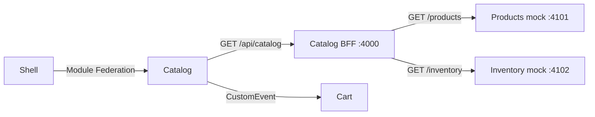

# Catalog BFF: từ frontend tới backend
Bản cũ chưa có BFF. Bản này thêm services/catalog-bff/server.cjs chạy Node.js :4000.
BFF phục vụ nhu cầu của Catalog, có thể do cùng đội Catalog sở hữu và triển khai riêng.
Không bắt buộc mỗi microfrontend phải có một BFF. BFF cũng có thể phục vụ một trải nghiệm web gồm nhiều MFE khi nhu cầu và ownership phù hợp.

## Luồng chạy thật

Module Federation tải mã UI. BFF phục vụ dữ liệu, không tải remoteEntry và không thay thế Shell.

## Từng file làm gì
- services/mock-services/server.cjs: hai HTTP server mô phỏng hai domain; cùng process để chạy lab gọn. Dữ liệu giả được chuyển khỏi frontend.
- services/catalog-bff/server.cjs: gọi hai API song song, deadline 1.5 giây, map backend schema thành UI DTO, lọc field nội bộ, quản lý lỗi.
- apps/catalog/src/api.js: frontend chỉ gọi một endpoint BFF.
- apps/catalog/src/App.jsx: loading/error/retry, dữ liệu sản phẩm, số tồn kho và request ID.
- tests/bff.test.cjs: kiểm tra qua HTTP thật trên cổng ngẫu nhiên, không phụ thuộc server đang chạy.

Products trả product_id/title/unit_price/internal_supplier; Inventory trả map ID → stock.
BFF trả id/name/price/icon/stock/canAddToCart. Trường internal_supplier không đi ra browser.
Đây là logic định hình response cho Catalog, vượt ra ngoài việc proxy chuyển tiếp request nguyên trạng.

## Chạy và quan sát
npm run dev chạy frontend, BFF và mocks. Mở http://localhost:3000 hoặc :3001.
Network lọc /api/catalog: browser chỉ gọi :4000, không gọi thẳng :4101/:4102.
Mở http://localhost:4000/api/catalog để xem JSON. Mouse hết hàng nên nút thêm bị khóa.
BFF in log requestId và thời gian; requestId cũng xuất hiện trong header và UI.

Muốn điều khiển từng phần:
1. Dừng npm run dev.
2. Terminal A: npm run dev:frontends
3. Terminal B: npm run dev -w @lab/mock-services
4. Terminal C: npm run dev -w @lab/catalog-bff
5. Dừng Terminal C, reload trang: frontend báo lỗi API, Shell/Cart vẫn chạy. Bật lại, bấm Thử lại API.

Thử chỉ lỗi Inventory: dừng BFF, trong PowerShell:
```powershell
$env:INVENTORY_URL = 'http://localhost:4199/inventory'
npm run dev -w @lab/catalog-bff
```
BFF trả 200 với warnings; tên và giá vẫn hiển thị, tồn kho null, nút thêm bị khóa.
Sau bài: Ctrl+C rồi Remove-Item Env:INVENTORY_URL và chạy BFF lại.
Tương tự đặt PRODUCTS_URL tới port không chạy → BFF trả 502 vì thiếu nguồn bắt buộc.
Không biến Inventory lỗi thành stock=0: chưa biết tồn kho khác với hết hàng.

## Contract API
GET /api/catalog → 200 { items, warnings, meta: { bff, sources, requestId } }.
Products lỗi hoặc sai schema → 502 { error: { code, message }, requestId }.
Inventory lỗi/timeout/thiếu ID → 200 + warnings, stock=null, canAddToCart=false.
GET /health chỉ kiểm tra process còn sống, không chứng minh upstream khỏe.
Request ID của demo xác định request BFF; chưa phải distributed tracing xuyên upstream.

## Cấu hình và deploy
BFF: PORT, PRODUCTS_URL, INVENTORY_URL, ALLOWED_ORIGINS (danh sách origin phân tách dấu phẩy).
Catalog build-time: CATALOG_BFF_URL, mặc định http://localhost:4000.
Ví dụ dùng reverse proxy cùng origin ở production:
```powershell
$env:CATALOG_BFF_URL = ''
npm run build
```
Proxy /api/catalog tới BFF; đặt rule API trước SPA fallback. Khi remote chạy trong Shell, URL tương đối dùng origin Shell; standalone cần proxy tương đương hoặc build với BFF URL tuyệt đối và CORS thích hợp.
Triển khai BFF bằng Node.js process/container riêng, không upload vào static CDN như remote UI. Mocks chỉ dành cho lab; production thay bằng domain services thật.
BFF dùng Node built-ins nên không cần thêm framework/dependency.

## Giới hạn
BFF này chỉ đọc catalog, chưa có auth, DB, checkout, cache, rate limiting hoặc tracing server.
Origin allowlist/CORS không phải xác thực; các HTTP client khác vẫn có thể gọi API không kèm Origin.
canAddToCart chỉ hỗ trợ hiển thị: chưa reserve stock, chưa kiểm tra quantity trong Cart. Checkout thật phải xác thực, kiểm tra lại giá/tồn và cập nhật giao dịch tại backend.
Không lấy user props từ Shell làm bằng chứng đăng nhập; đây vẫn là auth demo.
Nguồn: https://learn.microsoft.com/en-us/azure/architecture/patterns/backends-for-frontends
